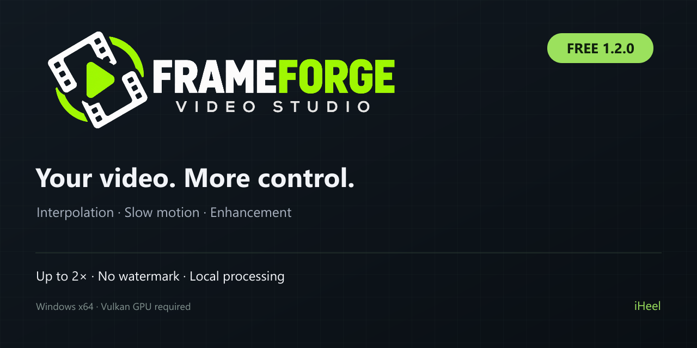
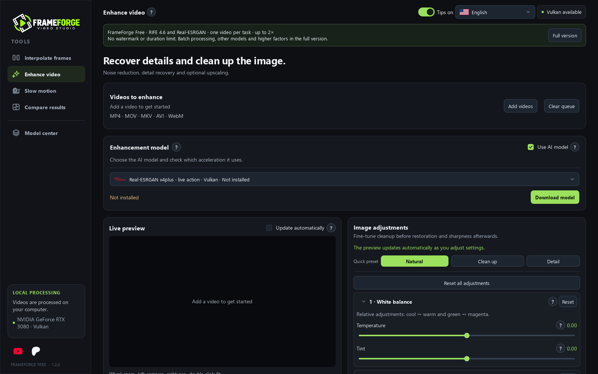
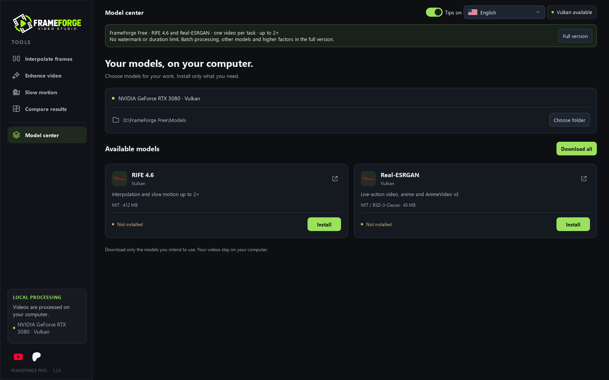

# FrameForge Free

**Smoother motion. More control. On your computer.**

## Available in 6 languages

The application, installer and uninstaller support all six languages.

|  |  |  |  |  |  |
| :---: | :---: | :---: | :---: | :---: | :---: |
| Português (Brasil) | English | Español | Русский | Français | Deutsch |

## Get the full version

**[Get FrameForge Full on Patreon →](https://www.patreon.com/c/iHeel)**

Want batch processing, additional AI models, higher interpolation and upscaling factors, and supported NVIDIA CUDA options? Choose an eligible membership on **iHeel’s Patreon** for access to the full edition when released. Visit Patreon for current availability and membership benefits.

FrameForge is one of iHeel’s projects; the Patreon also supports future projects.

> **Release preparation in progress:** installer downloads have not been published yet.

FrameForge Free is a Windows desktop application for video interpolation, slow motion and image enhancement. Try the core workflow without a subscription, watermark or edition-imposed duration limit.

## What you can do

- **Interpolate frames:** use RIFE 4.6 to increase the frame rate by up to 2×.
- **Create slow motion:** generate intermediate frames and keep the original FPS for up to 2× longer motion.
- **Enhance video:** use Real-ESRGAN x4plus, x4plus Anime or AnimeVideo v3, with output scaling up to 2×.
- **Adjust the image:** edit white balance, exposure, contrast, highlights, shadows, color, noise and sharpness. Compare adjustments in the live preview; including AI in the preview takes extra processing time.
- **Work on a smaller section:** select a clip instead of processing the whole video.
- **Control storage:** choose folders for extracted frames and temporary files, use block processing and choose whether to enable disk-space protection.

The Free edition processes **one video per task**. The full edition adds batch processing, additional models, higher factors and supported CUDA options. The Free edition uses **Vulkan**, including on NVIDIA hardware.

## Models are downloaded separately

The installer contains the application and its desktop runtime, not AI model packages. On first launch, choose to download both available packages or install each one when needed. Download sizes, confirmation and applicable model licenses are shown before installation.

Internet access is needed to download the models. Video processing runs locally after the required components are installed; your videos are not uploaded to a remote processing service. Model downloads contact their third-party hosts.

## Requirements

- Windows 10 or 11, **64-bit**.
- A Vulkan-capable **AMD, NVIDIA or Intel GPU** and a compatible vendor driver. Compatibility and speed depend on the exact hardware and driver; not every GPU has been physically tested.
- Free disk space for the application, selected model downloads and temporary processing files. Video length, resolution and settings can greatly increase storage use.
- No separate Python installation is required. CPU-only AI processing is not included.

Available interface and installer languages: **English, Portuguese (Brazil), Spanish, Russian, French and German**.

## Installing

1. Open **Releases** on this repository, choose the latest Free release and download **FrameForge-Free-1.2.0-Setup.exe**. The automatic “Source code” archives contain this distribution repository, not the application installer.
2. Run the installer, select the language and review the terms.
3. Prefer the default installation folder; very long folder paths can exceed Windows/.NET installer limits.
4. Start FrameForge Free and choose how to download the models.

The Free and full editions have separate default installation folders, shortcuts, settings and model storage. Keep one edition's files outside the other edition's installation folder.

## Windows security notice

This build is **not digitally signed**. Windows SmartScreen may show an unrecognized-app warning. Download from this creator's release page and compare the file against the supplied SHA-256 checksum. A checksum checks file integrity; it does not replace publisher signing. Do not disable your antivirus or system-wide protection.

## Keep expectations realistic

AI processing can introduce artifacts. Upscaling cannot guarantee recovery of detail missing from the original recording, and results depend on the footage, model and settings. Keep your original videos and test a short clip first. AI previews are not instantaneous.

## Support and more projects

Created by **iHeel**. FrameForge is one of my projects.

- Support: **iheel.support@gmail.com**
- [Support development and explore the full edition](https://www.patreon.com/c/iHeel)
- [YouTube](https://www.youtube.com/@iHeel-l)

The application is developed by iHeel; RIFE, Real-ESRGAN and other third-party components belong to their respective authors and retain their own licenses. Terms and third-party notices are included in the installer and the documentation download.

## Interface

Real captures of the Free interface; these are not AI quality comparisons.

## About this repository

This repository is a download and support hub. It does not publish the FrameForge application source code or license the application under MIT/GPL. Third-party components retain their own licenses and source-delivery requirements. See [installation help](docs/INSTALLATION.md), [FAQ](docs/FAQ.md), [third-party information](docs/THIRD-PARTY.md) and [support](SUPPORT.md).
